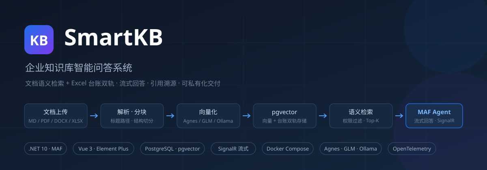

# SmartKB 企业知识库智能问答系统



可私有化交付的企业知识库智能问答系统：上传文档、配置字段与权限即可上线。基于 .NET 10 + Microsoft Agent Framework + PostgreSQL(pgvector) 构建，全程无技术堆砌，客户买走的是一套能自己运维的系统。

> 交付状态：全部功能已实现，**178 例单元测试全绿**；8 个 EF 迁移随 API 启动自动应用。设计决策与实现对照见 `docs/方案设计.md`，部署细节见 `docs/部署文档.md`。

## 功能特性

**智能问答（RAG）**
- MAF `ChatClientAgent` 编排 + SignalR 打字机流式输出，回答带引用出处（文档 / 片段 / 得分）
- 混合检索（可开关）：pgvector 向量路（HNSW 余弦）+ PostgreSQL 全文关键词路（表达式 GIN 索引），RRF 融合
- 可选重排：零依赖启发式 / OpenAI 兼容 `/rerank` API，外部失败自动降级，绝不中断问答
- 元数据过滤：字段与操作符白名单校验，过滤条件在 SQL 层强制
- 运行时配置：提示词、topK、温度、检索开关在后台「RAG 配置」热更新；**对话模型（Agnes / 智谱 / Ollama）同样支持运行时切换**，保存即生效

**文档接入**
- 上传后异步流水线：解析（docx / pdf / xlsx / txt / md）→ 切分（600 字 + 100 overlap）→ 向量化（1024 维，批 32）→ 入库，失败可重试
- Excel 台账额外逐行入结构化表，供 `query_ledger` 工具查询
- 可选 OCR sidecar：扫描件 PDF（解析文本 < 120 字符）自动调客户自备 OCR 服务补文本
- 队列双模式：单实例 `Memory`（进程内 Channel）；多实例 `Database`（`FOR UPDATE SKIP LOCKED` 认领，不重复消费，崩溃自动恢复）

**权限与安全**
- 三层授权：角色粗筛（admin / kb_manager / user）→ 知识库对象级（服务层 `IKbAccessGuard` 强制，越权 403）→ 文档级白名单（无记录 = 跟随库权限，零迁移成本）
- `admin` 角色是管理员唯一真相源；建库与创建者授权同事务原子写入
- 检索、台账、文档列表全链路同源过滤，不依赖前端隐藏；密钥一律只走环境变量
- CORS 生产默认不开放任何跨域来源

**可扩展工具（不改代码接入内部接口）**
- 后台登记内部 HTTP 接口即成为模型可调用的工具，与内置检索 / 台账工具并列
- 四条运行时硬约束：host 固定防 SSRF、密钥只走环境变量、响应限长 + 不跟随重定向、任何失败降级为可读文本
- 调用白名单（用户 / 角色）+ 知识库范围，过滤发生在注入模型之前

**集成与协议**
- OpenAI 兼容网关（`/v1/chat/completions`，非流式 + SSE）：已有 OpenAI SDK 的系统直接接入
- LDAP/AD 可选登录：search-then-bind 验证，通过自动开通本地账号
- AI 观测：每次问答落 token 用量、首字延迟（TTFT）、总耗时、工具调用、命中数
- 操作审计：全局过滤器自动记录所有 `/api` 写操作（只记元数据，不记请求/响应体）
- 分项健康检查：`GET /health` 四分项（database / pgvector / storage / llm），healthy / degraded / unhealthy 分级

## 技术栈

| 层 | 选型 |
|---|---|
| 运行时 | .NET 10 (LTS) |
| Agent 框架 | Microsoft Agent Framework（Microsoft.Agents.AI 1.19.0）+ `Microsoft.Extensions.AI` |
| Web | ASP.NET Core WebApi + SignalR，JWT 认证 |
| 数据库 | PostgreSQL 17 + pgvector（vector(1024)，HNSW 余弦 + 全文表达式 GIN） |
| ORM | EF Core + Npgsql.EntityFrameworkCore.PostgreSQL |
| 文档解析 | OpenXML SDK (docx) / PdfPig (pdf) / ClosedXML (xlsx)，全托管无外部依赖 |
| 前端 | Vue3 + Element Plus + SignalR client + Pinia，Markdown 渲染经 DOMPurify 消毒 |
| 日志/监控 | Serilog（结构化 + TraceId）+ OpenTelemetry（OTLP 可选导出） |
| 部署 | Docker Compose（db + api + web 三容器） |

**LLM 三模式**（`Llm__Mode` 切换，不改代码；对话模型支持运行时切换，Embedding 由部署配置决定——换 Embedding 等于换向量空间，须重建全部向量）：

| 模式 | Chat 模型 | Embedding | 场景 |
|---|---|---|---|
| Agnes（默认） | agnes-3.0-flash（OpenAI 兼容） | 智谱 embedding-3 | 默认对话通道 |
| Cloud | 智谱 glm-4.7 | 智谱 embedding-3 | 无 GPU、允许出网 |
| Local | Ollama/vLLM + Qwen3 | Ollama bge-m3 | 数据不出内网 |

## 架构

```
浏览器 (Vue3) ──HTTP/WS──► web (Nginx :80) ──反代──► api (ASP.NET Core :8080)
                                                        │
                          ┌─────────────────────────────┼──────────────────┐
                          │ Application 层              │ AI 层             │
                          │ 业务服务 + IKbAccessGuard    │ ChatOrchestrator  │
                          │ 配置中心 + 审计 + 观测       │ RAG 检索 + 工具    │
                          └─────────────┬───────────────┴────────┬─────────┘
                                        ▼                         ▼
                              db (PostgreSQL 17)          外部 LLM / Embedding
                              pgvector + 业务表            (可选 Rerank / OCR)
```

分层原则：Clean Architecture 简化版（Api → Application → Domain / Infrastructure / AI）。写操作权限在 Application 服务层强制（控制器只做角色粗筛）；配置读取走依赖倒置（`IRagSettingsProvider` / `ILlmSettingsProvider` 定义在 AI 层、实现在 Application 层，AI 层不反向引用业务层）；审计与探活属于宿主能力，放在 Api 层，业务服务零侵入。

**问答数据流**：

```
SignalR Ask(sessionId, kbIds, question)
  → 权限解析（可访问库集合，管理员不过滤）
  → 预检索注入上下文（省一次工具往返）
  → 工具注入：内置 search_knowledge / query_ledger + 后台登记的 HTTP 工具
    （按 可访问库 ∩ 工具知识库范围 ∩ 调用白名单 逐层过滤后才进 ChatOptions.Tools）
  → MAF ChatClientAgent 流式生成 → token / citations / done / error
  → 消息落库 + AI 观测落库（token / TTFT / 耗时 / 工具调用）
```

**文档入库流水线**：

```
上传 → Manage 权限校验 → 落盘 + 状态 Uploaded
  → 队列（Memory / Database）→ BackgroundService 消费
  → 解析(可选 OCR) → 切分(600字+100 overlap) → Embedding(批 32)
  → kb_chunks 入库 + 状态 Indexed / Failed(可重试)；Excel 台账逐行入 kb_ledger_rows
```

## 快速开始

### Docker 一键部署（生产 / 演示）

```bash
cp .env.example .env
# 编辑 .env：至少设置 POSTGRES_PASSWORD、JWT_SECRET_KEY(≥32字符)、
#            ADMIN_INITIAL_PASSWORD、LLM_API_KEY（或 LLM_AGNES_API_KEY）
docker compose up -d --build
```

打开 `http://localhost`（或 `WEB_PORT` 指定端口）→ 登录 → 开箱即用。首次启动自动执行迁移并种子默认管理员 `admin`（初始密码 = `ADMIN_INITIAL_PASSWORD`，未设置时为 `SmartKB@2026`，**登录后立即修改**）。

### 本地开发

```bash
# 1. 起 PostgreSQL（需 pgvector 扩展）
docker run -d --name smartkb-pg -p 5432:5432 \
  -e POSTGRES_DB=smartkb -e POSTGRES_USER=smartkb -e POSTGRES_PASSWORD=smartkb \
  pgvector/pgvector:pg17

# 2. 运行 API（首次启动自动迁移 + 种子；LLM Key 用环境变量注入）
cd src/SmartKB.Api && dotnet run
# 验证：http://localhost:5219/openapi/v1.json

# 3. 运行前端（Vite dev，代理 /api 与 /hubs 到 5219）
cd web && npm install && npm run dev
# 打开 http://localhost:5173
```

### 重新发布（Windows 开发机 → Linux 服务器）

```bat
publish.bat          :: 编译 → 打包 → 上传 → 备份(.env + pg_dump) → 替换源码 → 重建容器 → 验证
publish.bat api      :: 同上，只重建 api 容器
publish.bat web      :: 同上，只重建 web 容器
```

支持环境变量覆盖目标主机（`SMARTKB_HOST`）、`DRYRUN=1` 预览、`SKIP_DB_BACKUP=1` 跳过数据库备份。详见 `docs/重新发布手册.md`。

## 核心设计

### 权限模型

- **角色粗筛**：控制器 `[Authorize(Roles=...)]`，内置 admin / kb_manager / user。
- **知识库对象级**：所有针对具体库的写操作先过 `IKbAccessGuard.AssertManageAsync`（用户本人或所属角色有 `Manage` 授权，管理员短路）；`documentId` 与 `kbId` 强制绑定查询，杜绝跨库删改；授权入口防"给自己授权到无权库"。
- **文档级白名单**：`kb_document_grants`，无记录 = 跟随库权限；有记录 = 仅白名单用户/角色 + 库管理员可检索到（Manage 不受限）。过滤在向量路、关键词路、台账查询、文档列表四处同源下推。
- **管理员单一真相源**：`admin` 角色 ≡ 系统管理员，`sys_users.IsAdmin` 只是角色派生的冗余列；创建/更新用户、JWT 签发、检索权限、网关身份、后台菜单全部走同一判定，启动时自愈存量错配。

### 台账查询（非 Text2SQL）

`query_ledger` 只接受"字段 + 操作符 + 值"的结构化过滤参数（由 LLM 抽取），服务端做字段白名单 + 6 种操作符校验后拼参数化 JSONB 查询——杜绝 LLM 直接生成 SQL 的注入与越权风险。

### 工具安全边界

后台「工具注册表」登记的 HTTP 工具受四条运行时硬约束：① 参数只替换 URL 的 path/query 并 URL 编码，拼完断言主机未变（LLM 无法把请求打到别的机器）；② 密钥只存环境变量名，值运行时读取、不进日志与前端；③ 响应按字符限长、不跟随 3xx；④ 任何失败降级为可读文本，问答不中断。保存时与加载时双重静态校验；部署可用 `Tools__AllowedHosts` 锁死目标主机。建议只登记只读接口。

### OpenAI 兼容网关（默认关闭）

`.env` 中 `GATEWAY_ENABLED` / `GATEWAY_API_KEY` / `GATEWAY_SERVICE_USERNAME` 三者齐备才启用：

```bash
curl http://localhost/v1/chat/completions \
  -H "Authorization: Bearer $GATEWAY_API_KEY" -H 'Content-Type: application/json' \
  -d '{"model":"smartkb","messages":[{"role":"user","content":"保修期多久？"}]}'
# 流式加 "stream":true（标准 SSE + data: [DONE]）；引用走扩展字段 smartkb_citations
```

Key 绑定真实服务账号（权限完全按该账号计算，**切勿绑 admin**），SHA256 + 定长比较；也接受现有用户 JWT。权限不因协议放宽：`kb_ids` / `model=smartkb:1,2` 只是请求范围，仍与账号可访问库求交；system 消息默认忽略（`Gateway__AllowSystemPrompt=true` 才允许覆盖）。每次调用落会话、消息与 AI 观测，与 SignalR 共用面板。

### 企业集成（均可选，默认关闭）

- **LDAP/AD**：本地密码优先，本地失败且启用时走 search-then-bind 域控验证；通过自动开通本地账号（随机哈希，本地密码路径不可登录）并挂 `LDAP_DEFAULT_ROLE`。登录名 RFC 4515 转义防过滤器注入；绑定密码只走环境变量。
- **OCR sidecar**：`OCR_ENDPOINT` 指向客户自备 HTTP OCR 服务，扫描件 PDF 自动补文本；未启用或失败维持原行为。

## 数据库核心表

| 表 | 说明 |
|---|---|
| `kb_knowledge_bases` | 知识库，`field_schema`(jsonb) 定义客户自定义元数据字段（含 `filterable` 标记） |
| `kb_documents` / `kb_chunks` | 文档（status: Uploaded/Parsing/Indexed/Failed）与分块（`embedding vector(1024)` + metadata jsonb） |
| `kb_ledger_rows` | 台账结构化数据（`row_data` jsonb） |
| `kb_permissions` | 库级 ACL（user_id \| role_id 二选一，Read / Manage），KbId 外键级联删除 |
| `kb_document_grants` | 文档级白名单（无记录 = 跟随库权限） |
| `sys_users` / `sys_roles` / `sys_user_roles` | 标准 RBAC，`IsAdmin` 为角色派生冗余列 |
| `chat_sessions` / `chat_messages` | 会话与消息，messages 含 citations (jsonb) |
| `sys_settings` | `rag.*` / `llm.*` 运行时配置覆盖 |
| `ai_invocation_logs` | 每次问答一条：token / TTFT / 耗时 / 工具调用 / 成败 |
| `sys_audit_logs` | 每次写操作一条（只记元数据） |
| `sys_agent_tools` / `sys_agent_tool_grants` | 配置化 HTTP 工具（只存密钥变量名）与调用白名单 |

## 配置（生产环境密钥只走环境变量）

| 配置 | 环境变量 | 说明 |
|------|----------|------|
| 数据库 | `POSTGRES_PASSWORD`（compose） | 连接串由 compose 组装；本地开发用 `ConnectionStrings__Default` |
| JWT 密钥 | `JWT_SECRET_KEY` | ≥32 字符，仅环境变量 |
| 管理员初始密码 | `ADMIN_INITIAL_PASSWORD` | 首次部署后必须修改 |
| LLM 模式 | `LLM_MODE` | `Agnes`（默认）/ `Cloud` / `Local`；对话模型可在后台运行时切换 |
| LLM Key | `LLM_AGNES_API_KEY` / `LLM_API_KEY` | Agnes 与智谱 Key，仅环境变量；Agnes 模式下向量化回退智谱 |
| 外部 Rerank | `RERANK_API_KEY` 等 | 选填；未配置或失败自动降级启发式 |
| 文件存储 | `SmartKB__FileStoragePath` | Docker 固定 `/app/storage`（`kbstorage` 卷） |
| CORS 白名单 | `SmartKB:CorsAllowedOrigins` | 生产默认不开放（Nginx 同源反代）；开发配 `http://localhost:5173` |
| 工具主机白名单 | `TOOLS_ALLOWED_HOSTS` | 选填；填了之后后台只能登记这些主机 |
| 业务系统密钥 | 按后台登记的变量名（如 `ERP_API_TOKEN`） | 库里只存变量名，`.env` 配置后还需在 compose `api.environment` 列出 |
| OpenAI 网关 | `GATEWAY_ENABLED` 等 | 默认关闭；Key 仅环境变量 |
| LDAP/AD | `LDAP_ENABLED` / `LDAP_SERVER` 等 | 默认关闭；绑定密码仅环境变量 |
| OCR | `OCR_ENABLED` / `OCR_ENDPOINT` 等 | 默认关闭 |
| 队列模式 | `QUEUE_MODE` | `Memory`（默认）/ `Database`；**api 多实例部署必须切 `Database`** |

## API 一览

认证均为 JWT Bearer（SignalR 走 query string `?access_token=`）；标注（admin）的仅管理员可用。

- `POST /api/auth/login` · `GET /api/auth/me` · `POST /api/auth/change-password`
- `GET/POST/PUT /api/users`（admin）· `PUT /api/users/{id}/password` 重置密码
- `GET/POST/DELETE /api/roles`（admin）
- `GET/POST/PUT/DELETE /api/kbs` 知识库 CRUD（非管理员仅见被授权库）
- `GET/POST/DELETE /api/kbs/permissions` 授权管理
- `POST /api/kbs/{kbId}/documents`（multipart）上传 → 异步入库 · `GET` 列表 · `POST {id}/retry` · `DELETE {id}` · `GET/PUT {id}/grants` 文档级授权
- `GET/POST/DELETE /api/chats` · `GET /api/chats/{id}/messages` 会话与历史
- `GET /api/ai-usage/summary|daily|recent`（admin）AI 观测
- `GET/PUT /api/settings` · `POST /api/settings/reset`（admin）RAG 与模型运行时配置
- `GET /api/audit-logs`（admin）审计日志查询
- `GET/POST/PUT/DELETE /api/agent-tools` · `PATCH {id}/enabled` · `POST /test` · `GET/PUT {id}/grants`（admin）工具管理
- `GET /v1/models` · `POST /v1/chat/completions` OpenAI 兼容网关（默认关闭）
- `GET /health`（匿名）分项健康检查；`unhealthy` 503 / `degraded` 200

**SignalR 协议**（`/hubs/chat?access_token=<JWT>`）：客户端调用 `Ask(sessionId, kbIds, question)`（sessionId 传 null 自动建会话，kbIds 传空检索全部有权限的库）；服务端事件 `token`（增量文本）、`citations`（引用数组）、`done`（`{sessionId, answer}`）、`error`。

## 项目结构

```
SmartKB.slnx
├─ src/SmartKB.Domain          实体与枚举（9 个实体：用户/角色/知识库/文档/会话/观测/审计/工具/授权）
├─ src/SmartKB.Infrastructure  EF Core + Npgsql + pgvector、8 个迁移、种子（含启动自愈）
├─ src/SmartKB.Application     业务服务（认证/用户/角色/知识库/文档/会话/观测/配置中心/审计/工具管理）
│                              + IKbAccessGuard 对象级授权守卫 + ILdapDirectory 抽象
├─ src/SmartKB.AI              AI 层：解析(4 种格式+OCR) / 切分 / Embedding / RAG 检索（元数据过滤、
│                              RRF 融合、重排）/ MAF 编排器 / 配置化工具（定义校验、HTTP 执行器、
│                              动态 AIFunction、注册表）/ 运行时模型切换（SwitchableChatClient）
├─ src/SmartKB.Api             宿主：JWT、12 个控制器、SignalR Hub、全局审计过滤器、
│                              Health/ 分项探活、Gateway/ OpenAI 网关、Ldap/ 目录服务
├─ tests/SmartKB.Tests         xUnit 178 例（23 个测试文件）
├─ web/                        Vue3 前端：Chat（问答）/ Admin（管理后台 7 个面板）/ Login
├─ docker-compose.yml / .env.example / Dockerfile / nginx.conf / publish.bat
└─ docs/                       方案设计、部署文档、重新发布手册、知识库可见性诊断 SQL
```

前端管理后台（`web/src/components/`）：`UsersPanel` 用户 · `RolesPanel` 角色 · `KbPanel` 知识库（文档上传/状态/字段 schema/库授权/文档授权）· `ToolsPanel` 工具注册表（参数/模板/试运行/调用授权/知识库范围）· `SettingsPanel` RAG 与模型配置 · `UsagePanel` AI 观测 · `AuditPanel` 审计日志。后四个入口仅管理员可见（服务端同样强制）。

## 测试

```bash
dotnet test SmartKB.slnx    # 178 例全绿
```

覆盖：权限守卫与文档/工具授权闭环、切分边界、文档归属、检索增强（元数据白名单/操作符/RRF 融合/重排降级）、配置中心与模型运行时切换、审计与容错、健康分级、工具安全边界（host 固定/密钥不回显/响应截断/失败降级）、网关协议（SSE/usage/错误格式/权限闭包）、LDAP 开通与转义、OCR 门槛、队列双模式语义、admin 角色统一、AI 观测聚合（含 PostgreSQL 方言翻译回归）。

## 文档与边界

- `docs/方案设计.md` — 设计决策、实现状态对照（§0）、核心流程、范围边界
- `docs/部署文档.md` — 生产部署、配置项、常见问题
- `docs/重新发布手册.md` + `publish.bat` — 一键重新发布
- `docs/kb-visibility-diagnosis.sql` — 知识库可见性问题诊断与补授权脚本

**明确不做**：字段级权限（用文档拆分满足）、自由 Text2SQL、审计请求体记录、HA 编排（Database 队列已支持多实例扩容，负载均衡与告警编排按单机 Compose 交付定位）、LDAP 密码双向同步。
