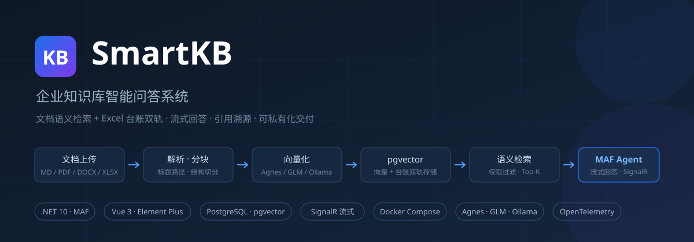

# SmartKB 企业知识库智能问答系统



.NET 10 + MAF + PostgreSQL(pgvector) 的可私有化交付知识库问答产品。

当前进度：**M1–M5 全部完成，v1.1 安全加固、v1.2 检索增强与配置中心、v1.3 审计日志与分项探活、v1.4 工具注册表与配置化 HTTP 工具、v1.5 工具级授权与 OpenAI 兼容网关、v1.6 文档级权限 / 工具知识库隔离 / LDAP / OCR / 多实例队列全部完成**。**P1 / P2 均无剩余待办**，145 例单测全绿。实现状态与待办对照见 `docs/方案设计.md` §0；私有化部署见 `docs/部署文档.md`。

## 项目结构

```
SmartKB.slnx
├─ src/SmartKB.Domain          实体与枚举（含 SysAuditLog、AgentTool、AgentToolGrant）
├─ src/SmartKB.Infrastructure  EF Core + Npgsql + pgvector、迁移、种子
├─ src/SmartKB.Application     业务服务（认证/用户/角色/知识库/授权/文档/会话/AI 观测/配置中心/审计/工具管理）
│                              + IKbAccessGuard 对象级授权守卫
├─ src/SmartKB.AI              AI 层（解析、切分、Embedding、RAG、MAF Agent、入库流水线）
│                              + 元数据过滤 / RRF 混合融合 / Rerank / RagSettings
│                              + Tools/ 配置化工具（定义校验、HTTP 执行器、动态 AIFunction、注册表与调用白名单）
├─ src/SmartKB.Api             WebApi 宿主（JWT、控制器、SignalR Hub、CurrentUser、中间件）
│                              + Health/ 分项探活、Filters/ 全局审计过滤器、Gateway/ OpenAI 兼容网关、Ldap/ 可选目录登录
├─ tests/SmartKB.Tests         xUnit 145 例（权限/台账/切分/文档归属/检索增强/配置中心/审计/探活/工具安全边界/工具授权与范围/网关协议与流程/文档授权/LDAP/OCR/队列模式）
├─ web/                        Vue3 + Element Plus 前端
├─ docker-compose.yml / .env.example / Dockerfile / nginx.conf
└─ docs/                       方案设计、部署文档、对标分析
```

# 本地开发（或直接用 Docker 一键部署，见 docs/部署文档.md）

```bash
# Docker 一键部署（生产/演示）
cp .env.example .env && vi .env && docker compose up -d --build
```

1. 起 PostgreSQL（需内置 pgvector 扩展）：

```bash
docker run -d --name smartkb-pg -p 5432:5432 \
  -e POSTGRES_DB=smartkb -e POSTGRES_USER=smartkb -e POSTGRES_PASSWORD=smartkb \
  pgvector/pgvector:pg17
```

2. 运行 API（首次启动自动执行迁移 + 种子默认管理员）：

```bash
cd src/SmartKB.Api
dotnet run
```

3. 验证：打开 `http://localhost:<port>/openapi/v1.json`，POST `/api/auth/login`：

```json
{ "username": "admin", "password": "SmartKB@2026" }
```

4. 运行前端（Vite dev，代理 `/api` 与 `/hubs` 到 API 的 5219 端口）：

```bash
cd web
npm install
npm run dev
```

打开 `http://localhost:5173` → 登录 → 智能问答 / 管理后台（admin、kb_manager 可见）。
生产部署：`npm run build` 产物在 `web/dist`，由 Nginx 托管并反代 API。

## 前端结构（web/）

- `src/views/Login.vue` 登录；`src/views/Chat.vue` 问答主界面（SignalR 打字机、会话列表、知识库多选、引用卡片、Markdown 渲染 + DOMPurify 消毒）
- `src/views/Admin.vue` 管理后台：用户 / 角色 / 知识库（文档上传与状态轮询、字段 schema 表格编辑含 `filterable`、用户与角色授权、文档行级「授权」弹窗）/ **工具注册表** / **AI 观测** / **RAG 配置** / **审计日志**（后四项仅管理员）
- `src/components/KbPanel.vue` 知识库面板：文档列表含状态与重试/删除，文档行「授权」弹窗（用户/角色多选，无记录 = 跟随库权限）
- `src/components/ToolsPanel.vue` 工具注册表：参数表格编辑、URL/请求体模板、鉴权变量名、**知识库范围多选**（留空 = 全部库可用）、启停、「试运行」与**调用授权白名单**（用户/角色多选，列表显示公开/受限）
- `src/components/SettingsPanel.vue` 运行时配置表单：按提示词/检索/重排/生成分组，显示值与来源（默认 / 已覆盖），保存后立即生效，支持一键恢复默认
- `src/components/AuditPanel.vue` 审计日志：分类/成败/时间/关键字筛选、分页、今日操作与失败数
- `src/api/index.js` axios 封装（JWT 注入、401 自动登出）；`src/stores/auth.js` Pinia 会话

## 关键配置（生产环境全部走环境变量，禁止写入文件）

| 配置 | 环境变量 | 说明 |
|------|----------|------|
| 数据库 | `ConnectionStrings__Default` | PostgreSQL 连接串 |
| JWT 密钥 | `Jwt__SecretKey` | ≥32 字符 |
| 管理员初始密码 | `SmartKB__AdminInitialPassword` | 首次部署后必须修改 |
| LLM 模式 | `Llm__Mode` | `Agnes`（默认，Agnes AI）/ `Cloud`（智谱 API）/ `Local`（Ollama） |
| LLM Key | `Llm__Agnes__ApiKey` / `Llm__Cloud__ApiKey` | Agnes 与智谱 API Key，仅环境变量注入；Agnes 模式下向量化回退智谱 |
| 外部 Rerank Key | `RAG__Rerank__Api__ApiKey`（compose 中为 `RERANK_API_KEY`） | 选填；未配置或调用失败自动降级启发式重排 |
| 文件存储 | `SmartKB__FileStoragePath` | 本地默认 `AppData/files`；Docker 由 compose 固定为 `/app/storage`（对应 `kbstorage` 卷） |
| CORS 白名单 | `SmartKB__CorsAllowedOrigins__0` 等 | 生产默认**不开放任何跨域来源**（Nginx 同源反代）；开发环境在 `appsettings.Development.json` 配 `http://localhost:5173` |
| 工具主机白名单 | `Tools__AllowedHosts`（compose 中为 `TOOLS_ALLOWED_HOSTS`） | 选填，逗号/分号分隔；填了之后后台只能登记这些主机，留空表示信任后台登记的地址 |
| 业务系统密钥 | 按后台登记的变量名，如 `ERP_API_TOKEN` | **库里只存变量名**；`.env` 中的变量还需在 compose 的 `api.environment` 显式列出才会注入容器 |
| OpenAI 兼容网关 | `Gateway__Enabled` / `Gateway__ApiKey` / `Gateway__ServiceUsername` / `Gateway__AllowSystemPrompt` | 选填，**默认关闭**；三者齐备才启用，Key 仅环境变量；详见 v1.5 章节 |
| LDAP/AD 登录 | `LDAP_ENABLED` / `LDAP_SERVER` / `LDAP_BASE_DN` / `LDAP_BIND_DN` / `LDAP_BIND_PASSWORD` 等 | 选填，**默认关闭**；绑定密码仅环境变量；详见 v1.6 章节 |
| OCR sidecar | `OCR_ENABLED` / `OCR_ENDPOINT` / `OCR_API_KEY_ENV` | 选填，**默认关闭**；客户自备 HTTP OCR 服务，扫描件 PDF 自动补文本 |
| 文档队列模式 | `SmartKB__QueueMode`（compose 中为 `QUEUE_MODE`） | `Memory`（默认，单实例）/ `Database`（多实例安全，SKIP LOCKED 认领）；api 多实例部署必须切 `Database` |

## v1.6 文档级权限、工具知识库隔离、LDAP 与 OCR（P2 收口）

**文档级授权**：知识库 → 文档行 → 「授权」。语义与工具白名单一致——文档**没有任何授权记录 = 跟随库权限**（库内可读用户都可见，升级零迁移成本）；一旦选中任意用户或角色，则**仅这些对象与库管理员**可检索到该文档（检索、台账查询与文档列表同时生效，Manage 权限不受限）。接口 `GET/PUT /api/kbs/{kbId}/documents/{docId}/grants`，写操作进审计 `set_document_grants`。

**工具知识库范围**：工具登记表新增「知识库范围」多选——限定了范围的工具只服务于这些库：问答指定的知识库与其无交集时，本次不注入该工具（连模型都看不到）。留空 = 全部知识库可用。

**LDAP/AD 可选登录**（默认关闭）：本地密码优先；本地校验失败且 LDAP 开启时走 search-then-bind 验证，通过即**自动开通**本地账号并挂 `LDAP_DEFAULT_ROLE`（须为已存在角色，留空则由管理员手动授权）。自动开通的账号密码哈希是随机值——本地密码路径不可登录，认证完全交给域控。登录名做 RFC 4515 转义防过滤器注入；绑定密码只走环境变量。

**OCR sidecar 可选接入**（默认关闭）：PDF 解析文本少于 120 字符（疑似扫描件）时，multipart POST 到 `OCR_ENDPOINT` 指定的客户自备 OCR 服务，响应取 JSON `text` 字段或纯文本进切分器；未启用/失败维持原行为（失败可重试）。

**多实例队列**：api 服务要扩多实例时设 `QUEUE_MODE=Database`——以 PostgreSQL `FOR UPDATE SKIP LOCKED` 逐条认领 `kb_documents`，多实例不会重复消费；单实例保持 `Memory` 不变。

## v1.5 工具级授权与 OpenAI 兼容网关（P2 之二）

**工具调用白名单**：管理后台 → 工具注册表 → 「授权」。一个工具没有任何授权记录 = **公开**（所有可登录用户可用，兼容 v1.4 行为）；一旦选中任意用户或角色，则**仅这些对象与管理员**在问答中能看到并调用该工具。过滤发生在工具注入模型之前（不进 `ChatOptions.Tools`），网关的服务间调用同样按绑定账号过滤；角色 ID 现查库，不信任可能过期的 JWT 声明。接口 `GET/PUT /api/agent-tools/{id}/grants`（仅 admin），写操作进审计 `set_tool_grants`。

**OpenAI 兼容网关**：客户已有 ChatGPT 客户端 / 业务系统可直接用 OpenAI SDK 接入，无需改造 SignalR。

```bash
# 1) 在 .env 中启用并配置（三者必须齐备，服务账号需先在「用户管理」创建并授权知识库）
GATEWAY_ENABLED=true
GATEWAY_API_KEY=<强随机字符串>
GATEWAY_SERVICE_USERNAME=svc_openai

# 2) 列出可访问知识库（model = smartkb:{kbId} 可限定检索范围）
curl http://localhost/v1/models -H "Authorization: Bearer $GATEWAY_API_KEY"

# 3) 非流式
curl http://localhost/v1/chat/completions \
  -H "Authorization: Bearer $GATEWAY_API_KEY" -H 'Content-Type: application/json' \
  -d '{"model":"smartkb","messages":[{"role":"user","content":"保修期多久？"}]}'

# 4) 流式：加 "stream":true，返回标准 chat.completion.chunk SSE + data: [DONE]
```

| 项 | 说明 |
|---|---|
| 鉴权 | `Authorization: Bearer <网关 Key>` 绑定到配置的服务账号；也接受现有用户 JWT（按本人权限）。Key 用 SHA256 + 定长比较，不回显、不进日志 |
| 权限 | `kb_ids` 或 `model = smartkb:1,2` 只是请求范围，仍与 `GetAccessibleKbIdsAsync` 求交；`session_id` 校验归属；工具按调用者白名单过滤 |
| system 消息 | **默认忽略**，统一由后台「RAG 配置」管控；`Gateway__AllowSystemPrompt=true` 才允许覆盖。`temperature` / `max_tokens` 允许请求覆盖并做范围校验 |
| 引用 | OpenAI 协议无引用字段，用扩展 `smartkb_citations` 返回（非流式在 `message`，流式单独一个 chunk）；标准客户端忽略即可 |
| 观测与会话 | 每次调用落会话、消息与 `ai_invocation_logs`，与 SignalR 共用「AI 观测」；不传 `session_id` 会新建 `[API] ...` 会话 |
| 错误格式 | `{ "error": { "message", "type", "code" } }`；网关未启用 503、鉴权失败 401、参数错误 400 |

**边界**：网关不做限流（建议 Nginx 对 `/v1/` 限流）；**切勿把服务账号设为 admin**，否则这把 Key 能读全部知识库、调用全部工具；静态 Key 泄漏等同该账号权限泄漏，需轮换。网关写请求不走全局审计过滤器（该过滤器只覆盖 `/api`），靠会话与观测留痕。

## v1.4 工具注册表与配置化 HTTP 工具（P2 之一）

后台路径：**管理后台 → 工具注册表**（仅管理员）。登记一个内部 HTTP 接口，模型在问答时会把它与知识库检索、台账查询并列按需调用，**不需要改代码或重新发版**。

| 项 | 说明 |
|---|---|
| 参数定义 | 表格编辑 `name / type / description / required / location`，服务端据此生成 function JSON Schema |
| URL 模板 | `https://erp.internal/api/device/{device_no}?year={year}`；占位符必须在参数表中声明 |
| POST 请求体 | 模板写 `{"deviceNo":{device_no}}`，占位符**不带引号**，服务端按类型生成 JSON 字面量并转义 |
| 鉴权 | 只填请求头名 + **密钥环境变量名**（如 `ERP_API_TOKEN`）+ 可选前缀 `Bearer `；值由运维在服务端设置，绝不入库、不回显 |
| 限制 | 超时 1–30 秒、响应 200–20000 字符截断、同时最多启用 20 个工具 |

**安全边界**：URL 的 scheme/host/port 来自配置，参数只替换 authority 之后的 path/query 并 URL 编码，拼完再次断言主机未变——LLM 无法把请求打到别的机器；不跟随 3xx 重定向；部署可用 `Tools__AllowedHosts` 锁死目标主机；任何失败（配置错、缺参、密钥未配、超时、上游 5xx）都降级为可读文本让模型继续回答，不中断问答。直接改库塞进来的坏配置只会被跳过并记 Warning。

**建议只登记只读接口**：试运行和模型调用都会真实产生副作用。v1.5 已补用户/角色级调用白名单，v1.6 再补**知识库范围**（限定工具只服务于特定库，与本次问答范围求交）。管理接口本身限 admin，写操作全部进审计日志（分类 `tools`）。

接口：`GET/POST/PUT/DELETE /api/agent-tools`、`PATCH /api/agent-tools/{id}/enabled`、`POST /api/agent-tools/test`、`GET/PUT /api/agent-tools/{id}/grants`（均仅管理员）。

## v1.3 审计日志与分项健康检查

**操作审计**：全局 `AuditLogFilter` 自动记录 `/api` 下所有写操作（登录、用户/角色/知识库/文档/授权、配置变更），落 `sys_audit_logs`。字段含操作人、语义化动作（`create_kb`、`reset_password` …）、路径、状态码、耗时、IP/UA、失败原因。

- **只记元数据，不记请求体与响应体**——密码、ApiKey、文档正文不会入库。
- GET 不记录，避免文档状态轮询刷出海量噪音；审计写入用独立 DI scope，失败只记日志、不影响业务请求。
- 查询 `GET /api/audit-logs`（仅管理员，分页 + 分类/成败/关键字/时间过滤）+ 后台「审计日志」面板。表会持续增长，按合规要求定期归档。

**分项健康检查**：`GET /health` 匿名可访问，返回 `{ status, db, checkedAt, checks[] }`，`checks` 含 database / pgvector / storage / llm 四项及各分项耗时与原因。

| 等级 | 触发 | HTTP |
|------|------|------|
| `healthy` | 四项全绿 | 200 |
| `degraded` | vector 扩展或 HNSW 索引缺失、LLM 端点不可达/凭据错/5xx | 200 |
| `unhealthy` | 数据库连不上、文件存储目录不可写 | 503 |

- **LLM 抖动只降级不判死**：避免编排器因为外部 API 临时故障反复重启容器；用 `/health` 做 liveness 时建议区分 readiness。
- LLM 探活按 `Llm:Mode` 走 `/models`（Agnes / Cloud）或 `/api/tags`（Local），3 秒超时；**结果缓存 10 秒**，避免监控每 5 秒打一次厂商端点触发限流。密钥只用于发请求，绝不回显到响应。
- 保留旧字段 `{ status, db }` 向后兼容；非关系型 provider（单测）标 `skipped`。

## v1.2 检索增强与配置中心

后台路径：**管理后台 → RAG 配置**（仅管理员）。参数存 `sys_settings`（`rag.*`），保存后立即对新问答生效，无需重启或重新发版；进程内缓存 10 秒 TTL，保存时主动失效。

| 能力 | 默认 | 实现要点 |
|------|------|----------|
| 元数据过滤 | 开 | 字段名只取知识库 `FieldSchema` 中 `filterable` 的字段，过 `^[A-Za-z0-9_]{1,64}$` 与操作符白名单（`eq/contains/gt/gte/lt/lte`）；先算出允许的 documentId 集合，两路召回的 SQL 都带 `DocumentId IN (...)`，权限与过滤都在 SQL 层强制 |
| 混合检索 | 关 | 向量路（pgvector 余弦 HNSW）+ 关键词路（PostgreSQL `to_tsvector/websearch_to_tsquery` + 中文精确词 ILIKE，配表达式 GIN 索引 `AddChunkFullTextIndex`），RRF 融合 `1/(60+rank)`，不做量纲归一化 |
| 重排 | 关 | `Heuristic`（零依赖：精确词覆盖率 + 融合分 + 长度惩罚）/ `Api`（OpenAI 兼容 `/rerank`，密钥仅环境变量）；外部调用失败自动降级启发式，绝不影响问答主流程 |
| 生成参数 | 温度 0.2 / 上限 2048 | 系统提示词、topK(8)、候选池(24)、温度、最大输出 token 全部运行时可调 |

配置接口：`GET /api/settings`（含默认值/生效值/来源）、`PUT /api/settings`（批量，key 白名单 + 类型与范围校验）、`POST /api/settings/reset`（删除全部覆盖）。**连接串与各类 ApiKey 不进配置中心**，只走环境变量。

## v1.1 安全加固

- **对象级授权**：所有针对具体知识库的写操作在 Application 服务层先过 `IKbAccessGuard`（用户本人或所属角色须有 `Manage` 授权，管理员短路），越权返回 **HTTP 403**；控制器只做角色粗筛。
- **documentId 归属绑定**：重试/删除强制同时匹配 `Id` 与 `KbId`，杜绝跨库删改。
- **授权入口防绕过**：`Grant` 前断言目标库 Manage 权限，堵住「给自己授权到无权库 → 检索合法召回全部内容」。
- **CORS**：生产默认拒绝所有跨域来源，白名单走配置。
- **存储卷**：`SmartKB__FileStoragePath` 与 compose 键名一致，容器重建不丢原始文件。
- **建库授权闭环**：非管理员建库后自动获得该库 `Manage` 授权，避免新守卫造成「能建不能管」。

## 测试

```bash
dotnet test SmartKB.slnx
```

145 例覆盖：权限守卫、台账白名单、切分边界、文档归属（20 例 v1.1）；元数据白名单/六种操作符、RRF 融合、关键词提取、启发式重排与降级、配置覆盖回退/范围钳制/缓存失效/`sys_settings` 读写闭环（23 例 v1.2）；审计查询过滤与写入容错、健康分级/脱敏/探活缓存（9 例 v1.3）；工具参数 DSL 与静态校验、URL host 固定与编码、POST JSON 字面量替换、密钥不回显、响应截断/重定向/超时降级、动态 AIFunction schema、注册表缓存与坏配置跳过、管理端白名单/配额/试运行闭环（35 例 v1.4）；工具授权用户/角色过滤与缓存失效、授权管理闭环、OpenAI 请求解析与 model 路由、非法请求、网关 Key 定长比较与服务账号绑定、默认关闭返回 503、非流式 OpenAI 结构与权限闭包、SSE 分块/`[DONE]`/usage 扩展、错误格式与 system 覆盖开关（18 例 v1.5）；文档列表授权过滤、授权管理闭环、工具知识库范围 DSL 校验、LDAP 自动开通与过滤器转义、OCR 门槛/响应解析/入库降级闭环、队列模式解析与双实现语义（40 例 v1.6）。

## API 一览

- `POST /api/auth/login` 登录 · `GET /api/auth/me` 当前用户 · `POST /api/auth/change-password` 改密
- `GET/POST/PUT /api/users`（admin）用户管理 · `PUT /api/users/{id}/password` 重置密码
- `GET/POST/DELETE /api/roles`（admin）角色管理
- `GET/POST/PUT/DELETE /api/kbs` 知识库 CRUD（非管理员仅见被授权库）
- `GET/POST/DELETE /api/kbs/permissions`（admin/kb_manager）授权管理
- `POST /api/kbs/{kbId}/documents`（multipart）上传 → 异步解析入库 · `GET` 列表含状态 · `POST {id}/retry` 重试 · `DELETE {id}` 删除 · `GET/PUT {id}/grants` 文档级授权（仅 Manage）
- `GET/POST/DELETE /api/chats` 问答会话管理 · `GET /api/chats/{id}/messages` 历史消息
- `GET /api/ai-usage/summary|daily|recent`（仅管理员）AI 调用观测：每次问答的 token 用量、首字延迟（TTFT）、总耗时、工具调用次数、命中数；每次问答（含失败/断连）自动落库 `ai_invocation_logs`
- `GET/PUT /api/settings` 与 `POST /api/settings/reset`（仅管理员）RAG 运行时配置
- `GET /api/audit-logs`（仅管理员）操作审计日志分页查询
- `GET/POST/PUT/DELETE /api/agent-tools`、`PATCH /api/agent-tools/{id}/enabled`、`POST /api/agent-tools/test`、`GET/PUT /api/agent-tools/{id}/grants`（仅管理员）配置化工具管理、试运行与调用授权
- `GET /v1/models`、`POST /v1/chat/completions`（网关 Key 或 JWT）OpenAI 兼容网关，默认关闭
- `GET /health`（匿名）分项健康检查；`unhealthy` 返回 503，`degraded` 返回 200

### 智能问答（SignalR `/hubs/chat`）

1. 连接：`/hubs/chat?access_token=<JWT>`（WebSocket 不支持自定义 header，token 走 query string）
2. 客户端调用：`Ask(sessionId, kbIds, question)` —— `sessionId` 传 null 自动建会话；`kbIds` 传空数组则检索全部有权限的库
3. 服务端事件（打字机）：
   - `token`（string）：增量文本，逐段推送
   - `citations`：引用出处数组（chunkId / documentId / fileName / seq / excerpt / score）
   - `done`：`{ sessionId, answer }` 完整回答，落库完成
   - `error`：错误消息

架构要点：MAF `ChatClientAgent` 编排 + 内置两个函数工具（`search_knowledge` 知识检索，支持 `filters` 元数据过滤 / `query_ledger` 台账结构化查询）+ v1.4 起运行时注入的配置化 HTTP 工具（动态 `AIFunction` 子类，schema 来自 `sys_agent_tools`）。工具闭包捕获权限范围（`GetAccessibleKbIdsAsync`，管理员为 null 不过滤），LLM 无法越权；v1.5 起调用方还必须传 `ToolCaller`，配置化工具按用户/角色白名单过滤后才注入；v1.6 起再按工具的知识库范围与本次检索范围求交，且检索/台账/文档列表按文档级授权过滤。台账查询字段白名单校验 + 参数化 SQL，杜绝注入。系统提示词与生成参数由 `IRagSettingsProvider` 在每次问答时注入，网关可通过 `ChatRequestOptions` 有限覆盖；AI 层通过依赖倒置不反向引用业务层。
